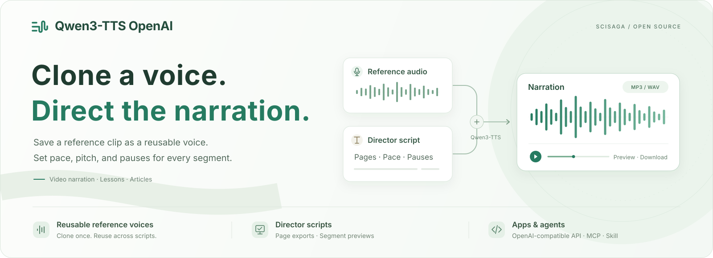

<p align="center">
  <a href="README.md">简体中文</a> · <strong>English</strong>
</p>

<p align="center">
  
</p>

<h1 align="center">Qwen3-TTS OpenAI</h1>

<p align="center"><strong>Reference voice cloning + director scripts, from manuscript to finished narration.</strong></p>

<p align="center">
  <a href="LICENSE"></a>
  <a href="https://github.com/Scisaga/qwen3-tts-openai/stargazers"></a>
  <a href="https://github.com/Scisaga/qwen3-tts-openai/issues"></a>
  <a href="https://github.com/Scisaga/qwen3-tts-openai/actions/workflows/ci.yml"></a>
  <br>
  <a href="Dockerfile"></a>
  <a href="docker-compose.yml"></a>
  <a href="#application-integration"></a>
  <a href="#install-the-qwen3-tts-openai-skill"></a>
</p>

<p align="center">
  Reuse reference voices with Qwen3-TTS. Use director scripts to control pace, pitch, and pauses for each page and segment.<br>
  Edit, preview, and download narration in the Chinese-language workbench, or connect applications and agents through an OpenAI-compatible speech API subset, REST API, or MCP.
</p>

<p align="center">
  <a href="#one-prompt-setup">One-prompt setup</a> ·
  <a href="#screenshots">Screenshots</a> ·
  <a href="#features">Features</a> ·
  <a href="#director-scripts-turn-narration-controls-into-an-execution-plan">Director scripts</a> ·
  <a href="#choosing-voices-for-narrative-presentations-and-video">Narration voices</a> ·
  <a href="#install-the-qwen3-tts-openai-skill">Agent Skill</a> ·
  <a href="#quick-start">Manual deployment</a> ·
  <a href="#application-integration">API &amp; MCP</a> ·
  <a href="#open-source-and-contributing">Contributing</a>
</p>

Built for video narration, lessons, narrated presentations, and articles. Reuse saved voices, generate long scripts in segments, and export MP3, WAV, and timelines. Self-host the service and run inference offline after downloading the models. Reference recordings, scripts, and generated audio stay in storage you manage.

## One-prompt setup

Copy the following prompt into **Codex or Claude Code** to install the Skill, check the environment, and deploy or connect to an existing service:

```text
Install the qwen3-tts-openai Skill for the agent client I am currently using,
then deploy or connect to the narration service on this host.
Repository: https://github.com/Scisaga/qwen3-tts-openai
Skill directory: skills/qwen3-tts-openai
Application code: qwen3_tts_openai/; dependency files: requirements/.
For native deployment, start the service with python -m qwen3_tts_openai.

First read SKILL.md and references/setup.md in that directory and check for Python 3.10+.
Run scripts/tts_skill.py install with the appropriate --client option,
then continue from the installed copy of the Skill.

Reuse an existing qwen3-tts-openai service whenever possible. For a new deployment,
follow the Skill guide and check Linux x86_64, Docker Compose v2, NVIDIA Container Toolkit,
and one explicitly selected NVIDIA GPU. Verify that the current build supports the target GPU;
follow the deployment guide and the actual runtime checks.
If the target GPU is ambiguous, ask me to choose. If the environment is incompatible,
report the missing requirements. Preserve existing configuration, models, and data.
Run doctor --mcp, configure MCP using the current client's supported method,
and verify that the actual tools can be discovered.
Report the Skill installation path, workbench URL, service readiness,
and whether the current client session needs to be reloaded.
```

For remote deployment, replace “this host” with “the configured SSH host tts-host.” If a service already exists, provide its root URL. To install only the Skill, change the first sentence to “Install the Skill only; do not deploy or modify a service yet.” Installing the Skill does not require a GPU; generating real narration requires a compatible service and a reference recording supplied by the user. See [Skill installation](#install-the-qwen3-tts-openai-skill) for manual commands.

## Screenshots

### Narration workbench

Choose a voice and edit plain text, a director script, or SSML on the left. Inspect pages, segments, controls, preflight issues, and the execution plan on the right. **Generate narration** (生成配音) runs preflight automatically; you can also check the script separately before submitting it.


| Voice management | Generation and playback |
| --- | --- |
| Each row places a clickable ID badge before the name. Copy the ID, preview and select voices, or create one through **Quick clone** or **Add voice**. | Follow progress, switch between full-script and per-page playback, and download MP3, WAV, timelines, and execution records. |
|  |  |

### Quick voice cloning

Record or upload a short clip and transcribe it automatically. Listen back, confirm the transcript, and create a voice. Switch between the two voice-creation tabs without losing completed recording drafts or form entries.


During generation, progress follows actual decoding steps. The page refreshes every half-second and shows the processing stage and generated audio duration. The final output length is not known in advance, so progress within a segment is marked as an estimate. Progress reaches 100% after the artifacts have been saved successfully.


| MCP integration | Runtime status |
| --- | --- |
| Copy the endpoint and client configuration, check the connection, and inspect the service's actual tools and parameters. | Check model readiness, audio tools, and control capabilities, including the distinction between numeric controls, expression instructions, and word alignment. |
|  |  |

<details>
<summary>Jobs and artifacts: generation history, progress, and results</summary>


</details>

<details>
<summary>Mobile preview: navigation and voice IDs</summary>


</details>

*Screenshots show the current Chinese-language interface, demonstration scripts, and an isolated test backend with controlled tones. Job identifiers are hidden. They illustrate the workflow; evaluate similarity, pronunciation, and voice quality with the real model. The repository does not include reference recordings, so add your own voice before first use. Supporting deployment, Skill, and development guides linked below are currently in Chinese.*

## Features

| Feature | What it does |
| --- | --- |
| Reference voice cloning | Upload a WAV and save a reusable voice, using either the full reference or speaker features only. |
| Readable voice IDs | Set a short ID when uploading or quick-cloning. Each row shows a clickable ID badge before its name; use the copied ID in API, MCP, or director scripts. |
| Quick cloning, optional | Record in the browser or upload a short clip, transcribe it, confirm the text, save the voice, and preview it with a new sentence. |
| LAN browser recording, optional | Provides a separate HTTPS entry point, a link from the HTTP workbench, and a public CA certificate download. Trust the certificate on the client computer to enable microphone access. |
| Multiple script formats | Paste plain text, or organize pages and segments with director-script JSON or SSML. |
| Preflight checks | Inspect actual segments, pronunciation, and controls before generation. Unsupported requirements are reported; degraded execution requires confirmation. |
| Audio controls | Adjust pace, pitch, gain, and pauses, then compare original and processed audio. |
| Preview and export | Generate full-script or per-page audio and preview selected sections. Export MP3, WAV, timelines, execution records, and the original input. |
| Jobs and caching | Inspect the queue, progress, and job history; cancel jobs; reuse verified generation and postprocessing caches. |
| Application integration | An OpenAI-compatible speech API subset, asynchronous REST API, and HTTP MCP. |
| MCP integration page | Check the actual connection, copy endpoints and configuration, and inspect the tool catalog and JSON Schema. |
| Pages and navigation | Five independent page URLs support reloads, bookmarks, and browser history, with desktop and mobile layouts. |
| Runtime status | Inspect readiness, devices, audio tools, and explanations of the active backend's control capabilities. |
| Agent Skill | Install the Skill for Codex or Claude Code to guide local or SSH deployment, connect to a service, choose voices, and generate and download narration. |
| Self-hosting | Local models and file storage with SQLite persistence. The workbench needs no separate frontend build, and models can be downloaded in advance for offline inference. |

## From script to narration

1. **Add a voice.** In **Voice management** (音色管理), open **Add voice** (添加音色) and upload a clear WAV recording you have permission to use. The default duration range is 1–30 seconds. Provide the matching transcript for full-reference cloning, or leave it blank to extract speaker features only. With ASR enabled, you can also record directly in **Quick clone** (快速复刻) and transcribe automatically.
2. **Enter the script.** Select a voice and paste the text. Use a director script or SSML when you need per-page settings or pronunciation rules.
3. **Generate narration.** The workbench runs preflight and submits a job. Resolve any issues first, or confirm the degradations listed in the plan.
4. **Preview and download.** Check pronunciation and transitions, then download MP3 or WAV. Multi-page scripts also support per-page playback and export.

Each page has its own URL and can be opened directly, reloaded, bookmarked, or opened in a new tab:

| Page | Path | Main actions |
| --- | --- | --- |
| Narration workbench | `/studio` | Plain text, director scripts, SSML, preflight, generation, full-script and per-page playback. |
| Voice management | `/voices` | Copy IDs, listen to references, select voices, quick-clone, or upload recordings. |
| Jobs and artifacts | `/jobs` | Inspect status, progress, and history, and open existing job results. |
| MCP integration | `/integrations/mcp` | Check connections, copy configuration, and inspect actual tools and parameters. |
| Runtime status | `/runtime` | Inspect model readiness, devices, audio tools, and control capabilities. |

URLs preserve page state: `/studio?mode=director` or `?mode=ssml` selects a script format, `/voices?tab=quick` or `?tab=upload` selects a voice-creation tab, and `/studio?panel=task&job=<job_id>` opens an existing job. Browser back/forward navigation restores the corresponding page. Leaving a recording page stops recording and releases the microphone.

Each voice row places a small-cornered `id | narrator` badge and the voice name on one line. Clicking either part of the badge copies only the ID, and keyboard activation is supported. Desktop text uses a moderate size; mobile keeps compact typography and an adapted layout.

## Director scripts: turn narration controls into an execution plan

A director script combines text and narration controls in one JSON document. Use `pages` and `segments` to organize pages and passages, with `rate`, `pitch`, `pause_after_ms`, and an optional `voice_id` for each segment. This is useful for lessons, presentations, and long narration that needs precise control.

1. **Plan.** Import the director script and voice profile, preserving page text, segmentation, and pronunciation rules. See the complete [director-script JSON](examples/narration_director.json) and [voice profile](examples/voice_profile.json) examples.
2. **Check.** Compile an execution plan first to inspect pronunciation, segments, voices, and controls. The default Base backend does not execute free-form emotional directions. Unsupported requirements are reported, and degraded execution proceeds only after acceptance. `target_seconds` is not a guarantee of exact duration.
3. **Generate and review.** Preview selected pages or segments, then listen to the full script or individual pages. Export MP3, WAV, timelines, and execution records.

Pace, pitch, and pauses use explicit numeric controls. Intent and expressive descriptions in a director script do not prove that the model achieves the requested sound. Plain text and SSML remain available as separate input formats.

## Choosing voices for narrative presentations and video

Choose a primary narration voice, then use a director script to arrange pace and pauses for each page. The following are readable ID suggestions and possible reference voices to compare in the [Microsoft Voice Gallery](https://speech.microsoft.com/portal/voicegallery):

| Suggested ID | Reference voice | Suggested use |
| --- | --- | --- |
| `yunxi` | Yunxi · natural male narration | Stories, explainers, and everyday presentation narration. |
| `yunjian` | Yunjian · documentary male narration | History, humanities, and documentary storytelling. |
| `yunyang` | Yunyang · professional male explanation | Business, technical presentations, and training. |
| `xiaohan` | Xiaohan · gentle female narration | Education, everyday stories, and humanities. |

These are reference choices and naming suggestions. Register a voice on your service before using its ID; check `GET /v1/voices` or Voice management for the actual list. Users provide and manage recordings, and local Qwen3-TTS generates the cloned narration. A reference sample's style does not mean that Base can execute Azure emotion tags.

Compare candidates using the same narration text, checking pronunciation, pace, long sentences, and transitions. For video production, export per-page MP3/WAV and segment timelines from the director script. Word-level subtitle timing needs a separate alignment step.

## Related skill repository

[Scisaga/skills](https://github.com/Scisaga/skills) collects independently installable tool skills. Its [build-narrated-presentation](https://github.com/Scisaga/skills/tree/main/skills/build-narrated-presentation) skill works with per-page scripts and presentation production: it can plan pace, pitch, and pauses and organize per-page audio, PPTX, or video outputs according to the chosen target. This project provides director-script preflight and local narration. When connecting the two, check the skill's configured speech backend and input contract.

The [qwen3-tts-openai Skill](skills/qwen3-tts-openai/SKILL.md) bundled here handles this service's installation, deployment, connection setup, voice selection, job queries, and audio downloads. Use the appropriate skill for presentation production or speech-service operation, and follow each repository's installation instructions.

## Quick voice cloning

### Enable and use it

Set the **root URL** of a [qwen3-asr-openai](https://github.com/Scisaga/qwen3-asr-openai) service in `.env`, then restart TTS to enable quick cloning. Leave it empty to disable the feature. This workflow requires `BACKEND=qwen-base`. The domain below is an example; replace it with your deployment address:

```dotenv
ASR_BASE_URL=http://asr.example.test:8001
ASR_TIMEOUT_SECONDS=120
REFERENCE_DRAFT_TTL_SECONDS=600
```

Do not append `/v1` to the ASR URL. The default transcription timeout is 120 seconds; adjust it for the queueing time of a shared ASR service.

Voice management provides two tabs:

| Tab | How it adds a voice |
| --- | --- |
| Quick clone (快速复刻) | Record in the browser or upload a short clip, transcribe it, and confirm the text to create a full-reference voice. |
| Add voice (添加音色) | Upload an existing WAV and optionally enter its transcript. Supports full-reference cloning or speaker features only. |

Switching tabs preserves completed recording drafts, voice names, and text. Switching away while recording stops capture and releases the microphone. The workbench's **Quick clone** (快速复刻) and **Add** (添加) buttons open the corresponding tabs.

1. In **Quick clone**, record clear speech. A 10–20-second clip is recommended; the supported range is 1–30 seconds. You can also upload WAV, WebM, M4A, MP3, OGG, FLAC, or MP4 clips.
2. The service converts the recording to mono PCM WAV and calls ASR's `POST /v1/audio/transcriptions`. Listen back and confirm that the transcript matches what was actually spoken. ASR may normalize numbers; correct them to match the recording.
3. Enter a voice name and click **Create voice** (生成音色). The voice is selected automatically once full-reference conditioning has been extracted.
4. Click **Preview with a new sentence** (用新句子试听) to check the clone, or **Use this voice** (使用这个音色) to return to the workbench.

If transcription fails, the recording draft is retained so you can retry or enter the text manually. An ASR outage does not affect existing voices or narration.

Short clips may wait behind long recordings on a shared ASR service. Select **Enter text manually** (手动填写文字) to skip waiting and create a voice using text you provide. Switching to this option during transcription preserves the same recording. API callers can create a draft with `transcribe=false` and request transcription later.

Recording drafts expire by default 10 minutes after the last transcription finishes and are cleaned up periodically. Saved voices persist independently. Submitting the same draft with the same name and text returns the same voice.

### HTTPS recording on a LAN

**Browser microphone access requires HTTPS or localhost.** A workbench opened over LAN HTTP cannot access the microphone, but uploading existing recordings still works. The project provides a separate HTTPS proxy that forwards requests to the TTS HTTP service and renews certificates automatically.

The following example uses HTTP port `8000` and HTTPS port `8443`. Set these values in `.env`:

```dotenv
HTTPS_PUBLIC_URL=https://voice.example.test:8443
HTTPS_UPSTREAM=127.0.0.1:8000
HTTPS_LOCAL_CA=1
```

Replace the example domain with a hostname or IP address your client device can resolve, and adjust the ports to your deployment. On Linux, run:

```bash
bash scripts/start_https.sh
```

The script starts the proxy in `docker-compose.https.yml` and exports its public root certificate to `static/local-ca.crt`. Restart TTS afterward so the workbench reads the HTTPS configuration. Docker deployments must also mount this certificate read-only at `/app/static/local-ca.crt`; see [LAN browser recording](docs/https-recording.md).

On each client computer, complete these steps before recording for the first time:

1. In the HTTP workbench's **Quick clone** tab, click **Download LAN certificate** (下载内网证书) and import it as a trusted root certificate. Instructions for Windows, macOS, Linux, and Firefox are in [Trusting the certificate](docs/https-recording.md#在访问电脑上启用录音).
2. Reopen the browser. Click **Open recording page** (打开录音页面) in the workbench to open the configured HTTPS URL, then click **Start recording** (开始录音) and grant microphone permission.

Once configured, the HTTP page links directly to the Quick clone tab at the HTTPS entry point. The HTTPS page provides the recording controls. The HTTP workbench and existing API URL remain available, and the TTS backend continues to access ASR over internal HTTP. If API authentication is enabled, enter the API token again on the HTTPS page.

If you already have a trusted domain and HTTPS proxy, set `HTTPS_PUBLIC_URL` and keep `HTTPS_LOCAL_CA=0`. For a native deployment, you can also set both certificate paths below to make `python -m qwen3_tts_openai` serve HTTPS directly on the configured `PORT`:

```dotenv
TLS_CERTFILE=/path/to/server.crt
TLS_KEYFILE=/path/to/server.key
```

The certificate must cover the hostname or IP used to access the service and be trusted by the client device. Serving TLS directly in Docker also requires mounting the certificate and private key. The separate proxy stores its CA and private keys in `.local/https/data`; retain this directory across restarts. These files are excluded from Git.

## Install the qwen3-tts-openai Skill

The [`qwen3-tts-openai` Skill](skills/qwen3-tts-openai/SKILL.md) combines deployment guidance, service diagnostics, and daily narration workflows. The client needs only **Python 3.10+** and supports Codex or Claude Code. Inference runs on a compatible Linux GPU host.

After obtaining the source, install for the current user from the repository root:

```bash
python3 skills/qwen3-tts-openai/scripts/tts_skill.py install --client codex
# Use --client claude for Claude Code, or --client both for both clients.
```

The default installation paths are `~/.agents/skills/qwen3-tts-openai` for Codex and `~/.claude/skills/qwen3-tts-openai` for Claude Code. In Windows PowerShell, replace `python3` with `py -3`. Use the installed copy for subsequent operations. For example, diagnose an existing local service:

```bash
python3 ~/.agents/skills/qwen3-tts-openai/scripts/tts_skill.py \
  --url http://127.0.0.1:8000 doctor --mcp
```

The installation command copies the Skill only. The agent performs deployment using the [installation and connection guide](skills/qwen3-tts-openai/references/setup.md), reusing existing services first. The client's REST helper does not need model dependencies. When authentication is enabled, it reads the token from `QWEN_TTS_API_TOKEN`. `doctor --mcp` checks readiness, API authentication, and MCP tools without generating audio.

After installation, ask your agent:

> Use qwen3-tts-openai to connect to my narration service and list its voices. With the voice I select, generate narration for this script. Run preflight first, wait for the job to finish, and download MP3 and WAV.

The Skill provides helpers for preflight, submission, job queries, and verified downloads. For complete commands, voice registration, director scripts, and SSML, see the [usage guide](skills/qwen3-tts-openai/references/usage.md). Invoke it explicitly with `$qwen3-tts-openai` in Codex or `/qwen3-tts-openai` in Claude Code.

## Quick start

Requires Linux, Docker Compose v2, a working NVIDIA driver, and NVIDIA Container Toolkit. The service uses one explicitly selected GPU with FP16 inference. Before deploying, check [GPU and build compatibility](docs/architecture.md#gpu-与构建兼容性) for the current runtime device checks and adaptation requirements.

The examples below use generic ports and device settings; adjust them to your environment.

### 1. Prepare configuration

After obtaining the source, run these commands in the project directory:

```bash
cp .env.example .env
nvidia-smi --query-gpu=index,uuid,name --format=csv
```

Edit `.env` to select one GPU. Replace the device placeholder below; other model settings can use the example configuration:

```dotenv
GPU_DEVICE=<GPU_UUID_OR_INDEX>
BIND_ADDRESS=127.0.0.1
PORT=8000
HF_HUB_OFFLINE=1
```

### 2. Build and download models

```bash
docker compose config --quiet
docker compose build

docker run --rm --env-file .env -e HF_HOME=/models \
  -v "$PWD/models:/models" qwen3-tts-openai:local \
  python scripts/download_models.py --http --online
```

The download retrieves complete, pinned model snapshots and verifies the weights. No GPU needs to be exposed to the download container. `--online` applies only to this download; the service still starts with its configured offline setting.

### 3. Start the workbench

```bash
docker compose up -d --no-build
docker compose logs -f qwen3_tts
```

Open <http://127.0.0.1:8000/>, wait until the model status shows **Ready** (已就绪), and add a voice. API documentation is available at <http://127.0.0.1:8000/docs>.

`/health` reports service liveness. `/ready` returns 200 when the model and audio tools are ready. Models are stored in `models/`; reference recordings, jobs, caches, and generated audio are stored in `data/`. Both directories are excluded from Git.

To enable API authentication, set `API_TOKEN` and send `Authorization: Bearer <token>` when calling `/v1/*` or `/mcp/`. See [.env.example](.env.example) for more settings.

### Native startup

On a Linux host with NVIDIA drivers, FFmpeg, FFprobe, and Rubber Band CLI installed, run the same application entry point from the checkout root. Configure `.env`, select the GPU, and check build compatibility as described above:

```bash
python3.12 -m venv .venv
.venv/bin/pip install --require-hashes -r requirements/requirements-gpu.lock
.venv/bin/python scripts/check_toolchain.py
.venv/bin/python scripts/download_models.py --http --online
.venv/bin/python -m qwen3_tts_openai
```

See [deploy/qwen3-tts-openai.service.example](deploy/qwen3-tts-openai.service.example) for a systemd template. Adjust the user, checkout, and virtual-environment paths. Set `WorkingDirectory` to the checkout root and `ExecStart` to the virtual environment's Python followed by `-m qwen3_tts_openai`.

### Inference speed

The default attention implementation is SDPA, and model generation runs in inference mode. CPU computation threads are configured as follows. Existing deployments should update these fields in `.env` and restart the service:

```dotenv
ATTN_IMPLEMENTATION=sdpa
TORCH_NUM_THREADS=1
TORCH_NUM_INTEROP_THREADS=1
```

These settings control CPU computation inside the model process. Narration jobs still run serially through a single GPU model process. Inspect `attention`, `cpu_threads`, and `hardware` in the `/health` response's `model` object to check the effective settings. `ATTN_IMPLEMENTATION=eager` remains available as an explicit alternative.

Qwen3-TTS generates audio step by step, alternating CPU scheduling and GPU computation during small decoding batches. GPU utilization alone does not measure generation speed. Compare warmed-up runs using the same voice, script, and generation parameters, and confirm that they did not hit the raw-audio cache. See [Development and validation](docs/testing.md) for the measurement procedure.

Optionally enable **CUDA Graph with a static KV cache** to capture the 15-step code-predictor sequence within each audio decoding step as a replayable computation graph:

```dotenv
CUDA_GRAPH_ENABLED=1
```

This option requires `ATTN_IMPLEMENTATION=sdpa`, supports the predictor interfaces of `qwen-base` and `qwen-custom`, and is disabled by default. Real GPU validation currently covers 1.7B Base; other modes require separate validation. No different model weights or additional inference library are needed. The first load warms up and captures the graph. Changing sampling parameters triggers recapture, and the process retains at most one graph. Text handling, reference-voice processing, and stopping conditions remain with the pinned official SDK.

After restarting, check `/ready` and confirm `inference_engine=cuda-graph-predictor` and `cuda_graph.captured=true` in the `/health` response's `model` object. Generation records include `replays_this_call`, and the graph path uses a separate cache from the official path. Sampling results can differ between execution paths, so check text completeness and voice quality for each. Capture failures are reported explicitly. Set `CUDA_GRAPH_ENABLED=0` and restart to return to the official path.

## Application integration

### OpenAI-compatible speech API

First add a voice through the workbench or upload a reference recording:

```bash
curl --fail-with-body http://127.0.0.1:8000/v1/voices \
  -F file=@reference.wav \
  -F 'name=My narration voice' \
  -F voice_id=narrator \
  -F 'ref_text=Enter the words actually spoken in the reference recording.' \
  -F mode=icl
```

Choose a readable `voice_id` such as `narrator` or `xiaoxiao`: 1–40 lowercase letters, Chinese characters, or digits, separated by single hyphens if needed. Omit it to generate an ID from the voice name, adding `-2`, `-3`, etc. for duplicates. A duplicate custom ID returns 409. Each voice has an `id | narrator` badge; click anywhere on it to copy the ID for API, MCP, or director-script use.

The response includes a `voice_id` and a reference-conditioning job. Wait for the voice to become ready, then replace `<voice_id>` below with the returned ID:

```bash
curl --fail-with-body http://127.0.0.1:8000/v1/audio/speech \
  -H 'Content-Type: application/json' \
  -d '{"model":"qwen3-tts","input":"Hello. This narration was generated locally.","voice":"<voice_id>","response_format":"mp3","speed":1}' \
  -o narration.mp3
```

This endpoint implements a subset of the OpenAI speech request format, with MP3, WAV, and speed support. `voice` is a locally registered voice ID, not an OpenAI preset voice name. Streaming output is not currently available. Use the asynchronous narration API for long scripts.

### REST and MCP

The workbench's **MCP integration** (MCP 接入) menu provides the service URL, copyable configuration, authentication guidance, and discovery of actual tools and their parameter schemas. **Check connection** initializes MCP and lists tools without submitting a narration job.

| Endpoint | Purpose |
| --- | --- |
| `POST /v1/voices` | Register a voice from a WAV, or submit `draft_id`, `name`, and confirmed `ref_text` to register a quick-clone voice. |
| `POST /v1/voices/references` | Upload and transcribe a short clip. Returns `draft_id`, `ref_text`, `sample_url`, expiration time, and transcription status. Set `transcribe=false` to skip waiting for ASR. |
| `POST /v1/voices/references/{draft_id}/transcribe` | Retry transcription for a recording draft. |
| `GET /v1/voices/references/{draft_id}/sample` | Play back the draft WAV using the same API authentication. |
| `DELETE /v1/voices/references/{draft_id}` | Delete a temporary recording without affecting saved voices. |
| `POST /v1/narrations/compile` | Run preflight and return an execution plan without invoking the GPU. |
| `POST /v1/narrations` | Submit plain-text, director-script, or SSML narration. |
| `GET /v1/jobs/{job_id}` | Query job status and artifact download links. |
| `POST /v1/jobs/{job_id}/cancel` | Request cancellation. |
| `/mcp/` | MCP Streamable HTTP with `submit_narration`, `get_job`, and `list_voices` tools. |

Examples are available in [narration_director.json](examples/narration_director.json), [voice_profile.json](examples/voice_profile.json), and [minimal.ssml](examples/minimal.ssml). The service's API documentation is the reference for complete request parameters.

## Current scope

- The default Qwen3-TTS Base backend clones reference voices. Pace, pitch, and gain are applied through audio postprocessing. Base does not support free-form expressive instructions; the combined-expression backend is experimental and must be explicitly enabled.
- Long scripts are generated as natural sentences or short passages. Timelines describe generated segments; exact start/end timestamps and duration control for individual words are not provided. Evaluate voice similarity, terminology, and transitions by listening to the actual output.
- SSML supports the implemented tags and numeric controls, rather than the complete Azure SSML specification. Unsupported controls are reported during preflight.

## Open source and contributing

### Project layout

```text
qwen3_tts_openai/          Python application package
  __main__.py             python -m qwen3_tts_openai entry point
  app.py                  HTTP endpoints, pages, and lifecycle
  synthesis_service.py    Narration, voice preparation, and job orchestration
  backends/               Model adapters and the isolated inference process
  ...                     Director compiler, audio processing, configuration, storage
requirements/             Service, GPU, and development .in and .lock files
static/                   Chinese-language workbench; no separate build
tests/                    API, jobs, audio, and runtime tests
scripts/                  Downloads, diagnostics, validation, and UI screenshots
deploy/                   HTTPS proxy and systemd templates
skills/                   Independently installable Agent Skill
docs/                     Architecture, validation, deployment, and UI images
examples/                 Director scripts, voice profiles, and SSML
```

See [Development and validation](docs/testing.md) for dependency installation, tests, browser checks, and screenshot updates. Models, runtime data, local configuration, and test outputs stay in the ignored `models/`, `data/`, and local output directories.

Report issues or submit pull requests to improve the interface, input formats, and model adapters. Include reproduction steps, error types, and sanitized logs when reporting a problem.

See [Architecture and capabilities](docs/architecture.md) and [Development and validation](docs/testing.md) for development guidance.

Project code is licensed under [Apache-2.0](LICENSE). Qwen3-TTS model weights and third-party components retain their own license terms; see [NOTICE](NOTICE).
