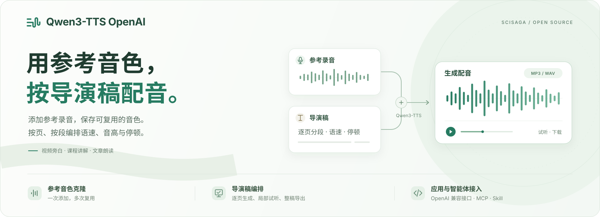
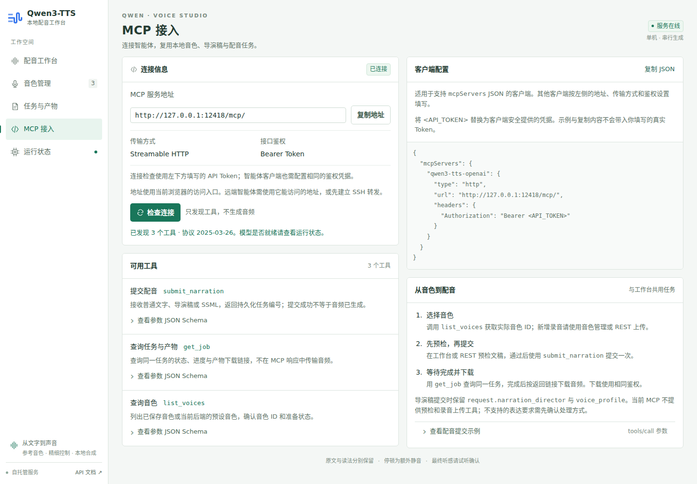
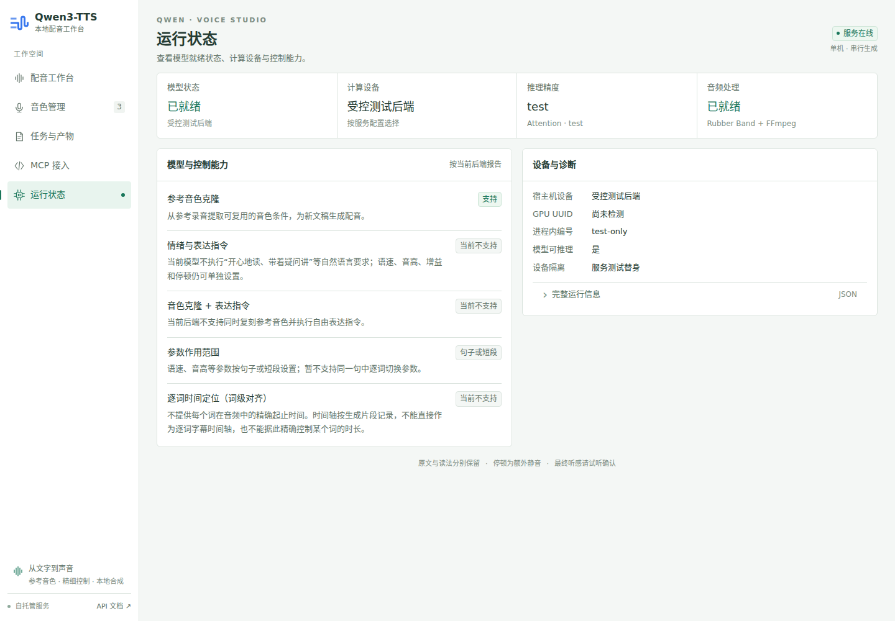
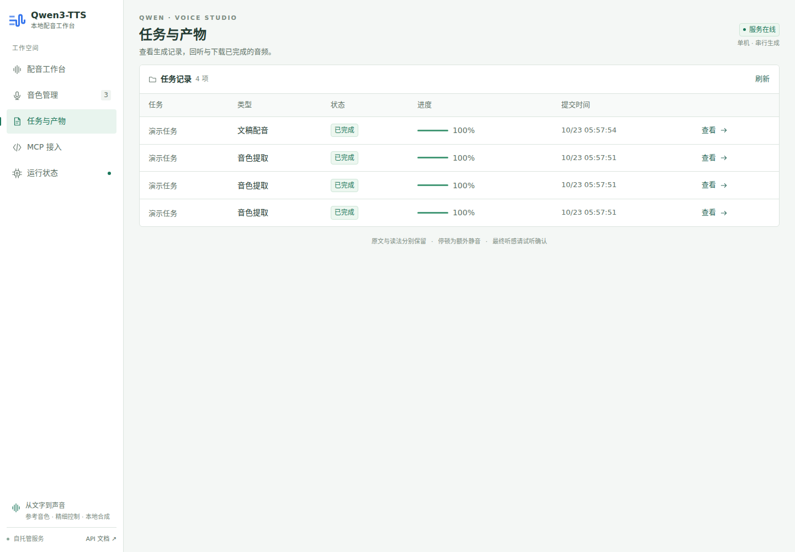
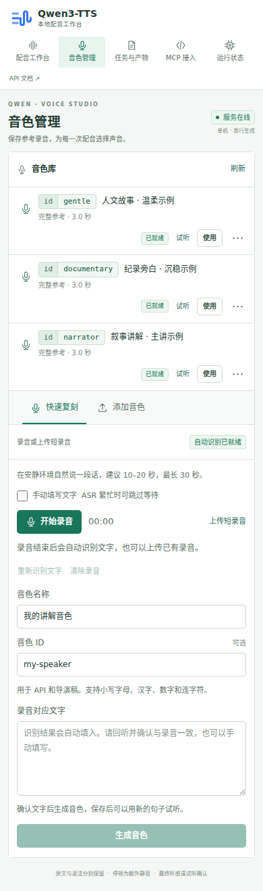

<p align="center">
  <strong>简体中文</strong> · <a href="README.en.md">English</a>
</p>

<p align="center">
  
</p>

<h1 align="center">Qwen3-TTS OpenAI</h1>

<p align="center"><strong>参考音色克隆 + 导演稿编排，从文稿到配音成品。</strong></p>

<p align="center">
  <a href="LICENSE"></a>
  <a href="https://github.com/Scisaga/qwen3-tts-openai/stargazers"></a>
  <a href="https://github.com/Scisaga/qwen3-tts-openai/issues"></a>
  <a href="https://github.com/Scisaga/qwen3-tts-openai/actions/workflows/ci.yml"></a>
  <br>
  <a href="Dockerfile"></a>
  <a href="docker-compose.yml"></a>
  <a href="#接入现有应用"></a>
  <a href="#安装-qwen3-tts-openai-skill"></a>
</p>

<p align="center">
  基于 Qwen3-TTS，复用参考音色，按导演稿逐页、逐段编排配音的语速、音高与停顿。<br>
  在中文工作台中编辑、试听与下载，也可通过 OpenAI 兼容语音接口子集、REST API 或 MCP 接入应用与智能体。
</p>

<p align="center">
  <a href="#一键安装提示词">一键安装</a> ·
  <a href="#界面预览">界面预览</a> ·
  <a href="#主要功能">主要功能</a> ·
  <a href="#导演稿把配音要求变成执行计划">导演稿</a> ·
  <a href="#叙事-ppt-与视频的音色选择">叙事音色</a> ·
  <a href="#安装-qwen3-tts-openai-skill">Skill 接入</a> ·
  <a href="#快速开始">手动部署</a> ·
  <a href="#接入现有应用">API 与 MCP</a> ·
  <a href="#开源与贡献">开源与贡献</a>
</p>

适合视频旁白、课程讲解、演示文稿配音和文章朗读。音色可反复使用，长稿可分段生成，成品可导出 MP3、WAV 和时间轴。服务支持自托管，模型下载完成后可离线推理，参考录音、文稿和生成音频由自己管理。

## 一键安装提示词

将下面的提示词复制到 **Codex 或 Claude Code**，让智能体安装 Skill，并完成环境检查、部署或已有服务接入：

```text
请为当前使用的智能体安装 qwen3-tts-openai Skill，并在当前主机部署或接入配音服务。
项目仓库：https://github.com/Scisaga/qwen3-tts-openai
Skill 目录：skills/qwen3-tts-openai

先阅读该目录的 SKILL.md 和 references/setup.md，检查 Python 3.10+，
使用 scripts/tts_skill.py install 为当前客户端安装 Skill，然后从已安装副本继续操作。

优先复用已有的 qwen3-tts-openai 服务；首次部署按 Skill 指引检查 Linux x86_64、
Docker Compose v2、NVIDIA Container Toolkit 和明确选中的单张 NVIDIA GPU，
并核对当前构建与目标 GPU 的兼容性，具体以 Skill 部署指南和实际运行检查为准。
多卡目标不明确时先让我选择，环境不兼容时报告缺失条件；保留现有配置、模型和数据。
完成后运行 doctor --mcp，按当前客户端支持的方式接入 MCP，验证实际工具发现。
服务源码位于 qwen3_tts_openai/，依赖文件位于 requirements/；原生启动使用 python -m qwen3_tts_openai。
告诉我 Skill 安装位置、工作台入口、服务就绪情况，以及当前会话是否需要重新加载。
```

远程部署时，将第一句的「当前主机」替换为「已配置的 SSH 主机 tts-host」；已有服务可直接注明根地址。只想安装 Skill 时，将第一句改为「只安装 Skill，暂不部署或修改服务」。安装本身不需要 GPU，真实生成需要兼容的服务和用户提供的参考录音。手动命令见 [Skill 安装与接入](#安装-qwen3-tts-openai-skill)。

## 界面预览

### 配音工作台

左侧选择音色并编辑文本、导演稿或 SSML；右侧查看逐页分段、控制参数、预检问题和执行计划。点击「生成配音」会自动预检，也可以先单独检查文稿。


| 音色管理 | 生成与试听 |
| --- | --- |
| ID badge 在前、名称在后，点击整个 badge 即可复制；通过「快速复刻 / 添加音色」创建、试听和选择音色。 | 查看任务进度，切换整稿或逐页试听，下载 MP3、WAV、时间轴和执行记录。 |
|  |  |

### 快速复刻

录音或上传短录音，自动识别对应文字；回听、确认文字后生成音色。两个添加方式在同一位置切换，已完成的录音草稿与填写内容会保留。


配音生成过程中，进度会随实际解码步骤更新，页面每半秒刷新，显示处理阶段和已生成的音频长度。模型生成的总长度无法提前确定，因此段内百分比标为估算；产物保存成功后显示 100%。


| MCP 接入 | 运行状态 |
| --- | --- |
| 复制服务地址与客户端配置，检查连接，查看服务实际暴露的工具及参数。 | 查看模型、音频工具与控制能力；区分数值控制、表达指令和逐词时间定位。 |
|  |  |

<details>
<summary>任务与产物：查看生成历史、进度和结果</summary>



</details>

<details>
<summary>手机预览：导航与音色 ID 布局</summary>



</details>

*截图使用当前界面、演示文稿和隔离测试后端，音频为受控测试音调，任务标识已隐藏。截图展示操作流程；音色相似度、读法与听感请在真实模型中试听确认。仓库不附带参考录音，首次使用请添加自己的音色。*

## 主要功能

| 功能 | 能做什么 |
| --- | --- |
| 参考音色克隆 | 上传 WAV，保存为可重复使用的音色；支持完整参考与仅说话人特征两种方式。 |
| 可读音色 ID | 添加或快速复刻时自定义简短 ID；列表先显示可点击复制的 ID badge，再显示名称，可直接用于 API、MCP 和导演稿。 |
| 快速复刻（可选） | 在网页录音或上传短录音，自动识别对应文字，确认后保存音色并用新句子试听。 |
| 内网网页录音（可选） | 提供独立 HTTPS 入口、HTTP 页面跳转按钮和公共证书下载；访问电脑信任证书后可使用麦克风。 |
| 多种文稿入口 | 直接粘贴普通文字，或使用导演稿 JSON、SSML 编排段落与页面。 |
| 生成前预检 | 展示实际生成分段、读法和控制参数；不支持的要求会明确报告，降级执行需要确认。 |
| 声音控制 | 调整语速、音高、增益和停顿，并对照原始与处理后的音频。 |
| 试听与导出 | 支持整稿、逐页音频，以及局部试生成；导出 MP3、WAV、时间轴、执行记录和输入原文。 |
| 任务与缓存 | 查看队列、进度和生成历史，取消任务；复用已验证的生成与后处理缓存。 |
| 应用接入 | 提供 OpenAI 兼容语音接口子集、异步 REST API 与 HTTP MCP。 |
| MCP 接入页 | 检查真实连接、复制地址和配置，查看工具目录与 JSON Schema。 |
| 页面与导航 | 五个页面使用独立 URL，支持刷新、收藏和前进后退；桌面与手机自适应布局。 |
| 运行状态 | 查看就绪状态、设备及音频工具，说明当前后端支持的控制方式。 |
| Agent Skill | 为 Codex / Claude Code 安装 Skill，引导本机或 SSH 部署、接入服务、选择音色并生成和下载配音。 |
| 自托管 | 本地模型与文件存储，SQLite 持久化；网页无需单独构建，模型可预下载后离线运行。 |

## 从文稿到配音

1. **添加音色**：在「音色管理」选择「添加音色」Tab，上传一段有权使用的清晰 WAV 录音，默认支持 1–30 秒。填写与录音一致的文字可使用完整参考；留空则仅提取说话人特征。启用 ASR 后，也可在「快速复刻」Tab 直接录音并自动识别文字。
2. **输入文稿**：选择音色，粘贴要朗读的文字。需要逐页参数或发音规则时，切换到导演稿或 SSML。
3. **生成配音**：点击生成，工作台自动预检并提交任务；若存在问题，先修正文稿或确认计划中列出的降级项。
4. **试听与下载**：确认读法和段落衔接，下载 MP3 或 WAV。多页文稿还可以逐页试听与导出。

各页面都可以通过独立地址打开、刷新、收藏或在新标签页使用：

| 页面 | 路径 | 主要操作 |
| --- | --- | --- |
| 配音工作台 | `/studio` | 文本、导演稿、SSML，预检和生成，整稿与逐页试听。 |
| 音色管理 | `/voices` | 查看与复制 ID、回听参考录音、选择音色、快速复刻和上传。 |
| 任务与产物 | `/jobs` | 查看任务状态、进度和历史，打开已有任务结果。 |
| MCP 接入 | `/integrations/mcp` | 检查连接、复制配置、查看真实工具与参数。 |
| 运行状态 | `/runtime` | 查看模型就绪状态、设备、音频工具和能力说明。 |

URL 同时保留页面内状态：`/studio?mode=director` 或 `?mode=ssml` 打开文稿模式，`/voices?tab=quick` 或 `?tab=upload` 打开音色添加方式，`/studio?panel=task&job=<job_id>` 直达已有任务。浏览器前进后退会恢复对应页面，切走录音页会停止录音并释放麦克风。

音色行将小圆角的 `id | narrator` badge 与名称放在同一行，点击任一分区都只复制 ID，支持键盘激活。桌面使用适中的字号，手机保持紧凑字号与适配布局。

## 导演稿：把配音要求变成执行计划

导演稿将正文与配音控制放在同一份 JSON 中。通过 `pages`、`segments` 编排页面与段落，为片段设置 `rate`、`pitch`、`pause_after_ms` 和可选 `voice_id`，适合课程、演示文稿和需要精细控制的长篇旁白。

1. **编排**：导入导演稿及音色配置，保留逐页正文、分段和发音规则。完整示例见 [导演稿 JSON](examples/narration_director.json) 与 [音色配置](examples/voice_profile.json)。
2. **预检**：先编译执行计划，检查实际读法、分段、音色和控制参数。默认 Base 后端不执行自由情绪指令；不支持的要求会明确报告，接受降级后才执行。`target_seconds` 不代表严格时长保证。
3. **生成与复核**：支持指定页面、片段的局部试生成；完成后试听整稿或逐页音频，导出 MP3、WAV、时间轴和执行记录。

语速、音高与停顿以明确的数值控制执行；导演稿中的意图和表达描述不等于模型已实现相应听感。普通文字和 SSML 仍可作为独立入口使用。

## 叙事 PPT 与视频的音色选择

叙事型演示文稿可以先确定一条主讲声线，再用导演稿编排逐页语速和停顿。下面给出便于记忆的 ID 命名与选声建议，可在 [微软官方音色库](https://speech.microsoft.com/portal/voicegallery) 比较参考声线：

| 建议 ID | 参考音色 | 建议用途 |
| --- | --- | --- |
| `yunxi` | 云希 · 自然叙事男声 | 故事、科普和日常 PPT 主讲。 |
| `yunjian` | 云健 · 纪录旁白男声 | 历史、人文和纪录片式叙事。 |
| `yunyang` | 云扬 · 专业讲解男声 | 商务、技术与培训内容。 |
| `xiaohan` | 晓涵 · 温柔叙事女声 | 教育、生活和人文故事。 |

这些是参考声线与命名建议，需在自己的服务中注册后才可使用；以 `GET /v1/voices` 或音色管理页的实际列表为准。录音由使用者自行提供并管理，配音由本地 Qwen3-TTS 克隆生成。参考录音的风格不代表 Base 后端可以执行 Azure 情绪标签。

选择时让候选音色朗读同一份叙事稿，对比读法、语速、长句与段落衔接。视频制作可使用导演稿生成的逐页 MP3/WAV 和片段时间轴；逐词字幕时间需要另行对齐。

## 相关技能仓库

[Scisaga/skills](https://github.com/Scisaga/skills) 汇集可独立安装的工具技能。其中 [build-narrated-presentation](https://github.com/Scisaga/skills/tree/main/skills/build-narrated-presentation) 面向逐页讲稿与演示文稿制作，可编排语速、音高和停顿，并按目标组织逐页音频、PPTX 或视频产物。本项目提供导演稿预检与本地配音服务；实际串联时需按技能配置核对语音后端与输入协议。

本仓库随附的 [qwen3-tts-openai Skill](skills/qwen3-tts-openai/SKILL.md) 则负责本服务的安装部署、接入、音色选择、任务查询和音频下载。演示文稿制作与语音服务运维分别使用对应技能，安装说明以各自仓库为准。

## 快速音色复刻

### 启用与使用

在 `.env` 配置 [qwen3-asr-openai](https://github.com/Scisaga/qwen3-asr-openai) 服务的**根地址**，重启 TTS 服务后即可启用「快速复刻」。留空关闭此入口；需要使用 `BACKEND=qwen-base`。以下地址为示例域名，请替换为自己的部署地址：

```dotenv
ASR_BASE_URL=http://asr.example.test:8001
ASR_TIMEOUT_SECONDS=120
REFERENCE_DRAFT_TTL_SECONDS=600
```

ASR 地址不要追加 `/v1`。识别超时默认 120 秒，可按共享 ASR 服务的排队时间调整。

音色管理页提供两个并列 Tab：

| Tab | 添加方式 |
| --- | --- |
| 快速复刻 | 网页录音或上传短录音，自动识别文字，确认后使用完整参考模式生成音色。 |
| 添加音色 | 上传已有 WAV，手动填写可选参考文字，支持完整参考或仅说话人特征。 |

切换 Tab 会保留已完成的录音草稿、音色名称和文字。正在录音时切走会停止录音并释放麦克风。工作台的「快速复刻」和「添加」按钮分别打开对应 Tab。

1. 在「快速复刻」录制清晰语音，建议 10–20 秒，支持 1–30 秒；也可上传 WAV、WebM、M4A、MP3、OGG、FLAC、MP4 短录音。
2. 服务将录音转换为单声道 PCM WAV，并调用 ASR 的 `POST /v1/audio/transcriptions`。回听录音，确认自动识别的文字与实际内容一致；ASR 可能会归一化数字，请按实际说法修正。
3. 填写音色名称，点击「生成音色」。完整参考条件提取完成后，音色会自动选中。
4. 点击「用新句子试听」检查克隆效果，或点击「使用这个音色」返回工作台配音。

识别失败时录音草稿会保留，可以重新识别或手动填写文字。ASR 故障不影响已有音色和配音服务。

共享 ASR 在处理长录音时，短录音也可能排队。勾选「手动填写文字」可立即跳过识别等待，填写文字后生成音色；识别等待期间切换此选项也会保留同一份录音。接口调用可传 `transcribe=false` 创建草稿，稍后再使用重新识别接口。

录音草稿默认在最后一次识别完成后的 10 分钟过期，并定期清理；已保存的音色独立持久化。重复提交同一草稿与相同名称、文字会返回同一音色。

### 局域网 HTTPS 录音

**网页麦克风需要 HTTPS 或 localhost。** 通过局域网 HTTP 地址访问时，浏览器无法开启麦克风，仍可上传已有录音。项目提供独立 HTTPS 代理，转发到原有 TTS HTTP 服务，证书自动续期。

以下使用示例域名，TTS HTTP 端口为 `8000`、HTTPS 端口为 `8443`，在 `.env` 中配置：

```dotenv
HTTPS_PUBLIC_URL=https://voice.example.test:8443
HTTPS_UPSTREAM=127.0.0.1:8000
HTTPS_LOCAL_CA=1
```

将示例域名替换为访问设备能解析的域名或 IP，端口按自己的部署配置调整。在 Linux 上执行：

```bash
bash scripts/start_https.sh
```

脚本启动 `docker-compose.https.yml` 中的代理，并将公共根证书导出为 `static/local-ca.crt`。随后重启 TTS 服务，使页面读取新的 HTTPS 配置；Docker 部署还需将该证书只读挂载到 `/app/static/local-ca.crt`，详见 [内网网页录音](docs/https-recording.md)。

首次在访问电脑上使用录音时：

1. 在自己的 HTTP 工作台「快速复刻」Tab 点击「下载内网证书」，将其导入电脑的受信任根证书。Windows、macOS、Linux 和 Firefox 的操作见 [证书信任步骤](docs/https-recording.md#在访问电脑上启用录音)。
2. 重新打开浏览器，从工作台点击「打开录音页面」，进入所配置的 HTTPS 地址，点击「开始录音」并允许网站使用麦克风。

配置后，HTTP 页按钮显示「打开录音页面」，点击可直接进入 HTTPS 的快速复刻 Tab；HTTPS 页提供「开始录音」。HTTP 工作台和原有 API 地址继续可用，ASR 仍由 TTS 后端通过内网 HTTP 连接。启用接口鉴权时，需要在 HTTPS 页面重新填写 API Token。

已有受信任域名与 HTTPS 代理时，设置 `HTTPS_PUBLIC_URL` 并保持 `HTTPS_LOCAL_CA=0` 即可。也可以在原生部署中同时配置以下两个文件，让 `python -m qwen3_tts_openai` 在当前 `PORT` 直接使用 HTTPS：

```dotenv
TLS_CERTFILE=/path/to/server.crt
TLS_KEYFILE=/path/to/server.key
```

证书需覆盖访问域名或 IP，并受到访问设备信任。Docker 直接启用 TLS 时，还需挂载证书与私钥。独立代理的 CA 和私钥保存在 `.local/https/data`，需要持久保留；这些文件不进入 Git。

## 安装 qwen3-tts-openai Skill

[`qwen3-tts-openai` Skill](skills/qwen3-tts-openai/SKILL.md) 将安装部署、服务诊断和日常配音流程封装在一起。客户端只需 **Python 3.10+**，支持 Codex 与 Claude Code；推理服务运行在兼容的 Linux GPU 主机。

取得源码后，在仓库根目录安装到当前用户：

```bash
python3 skills/qwen3-tts-openai/scripts/tts_skill.py install --client codex
# Claude Code 使用 --client claude；同时安装使用 --client both
```

默认安装到 `~/.agents/skills/qwen3-tts-openai`（Codex）或 `~/.claude/skills/qwen3-tts-openai`（Claude Code）。Windows PowerShell 将 `python3` 换为 `py -3`。后续使用已安装的副本，例如诊断已启动的本机服务：

```bash
python3 ~/.agents/skills/qwen3-tts-openai/scripts/tts_skill.py \
  --url http://127.0.0.1:8000 doctor --mcp
```

安装命令只复制 Skill；部署由智能体按 [安装、部署与接入](skills/qwen3-tts-openai/references/setup.md) 执行。已有服务优先复用，客户端的 REST helper 无需安装模型依赖；启用鉴权时从 `QWEN_TTS_API_TOKEN` 环境变量读取 Token。`doctor --mcp` 检查就绪状态、API 鉴权与 MCP 工具，不生成音频。

安装后可直接对智能体说：

> 使用 qwen3-tts-openai，连接我的配音服务，列出现有音色。使用我选定的音色为这篇文稿生成中文配音，先预检，等待任务完成后下载 MP3 和 WAV。

Skill 提供预检、提交、任务查询与校验下载工具。完整命令、音色注册、导演稿与 SSML 用法见 [配音使用指南](skills/qwen3-tts-openai/references/usage.md)。Codex 可用 `$qwen3-tts-openai` 显式调用；Claude Code 使用 `/qwen3-tts-openai`。

## 快速开始

需要 Linux、Docker Compose v2、可工作的 NVIDIA 驱动和 NVIDIA Container Toolkit。服务按单张 GPU、FP16 推理部署；开始前请核对 [GPU 与构建兼容性](docs/architecture.md#gpu-与构建兼容性)，其中记录了当前代码的设备检查和适配范围。

以下是通用部署示例，可根据自己的环境调整端口与设备。

### 1. 准备配置

获取代码后，在项目目录执行：

```bash
cp .env.example .env
nvidia-smi --query-gpu=index,uuid,name --format=csv
```

编辑 `.env`，选择一张目标 GPU。下面的设备字段需要替换，其他模型参数可沿用示例配置：

```dotenv
GPU_DEVICE=<GPU_UUID_OR_INDEX>
BIND_ADDRESS=127.0.0.1
PORT=8000
HF_HUB_OFFLINE=1
```

### 2. 构建并下载模型

```bash
docker compose config --quiet
docker compose build

docker run --rm --env-file .env -e HF_HOME=/models \
  -v "$PWD/models:/models" qwen3-tts-openai:local \
  python scripts/download_models.py --http --online
```

预下载会获取固定版本的完整模型快照并校验权重，不需要暴露 GPU。`--online` 仅用于这次下载；服务仍按 `.env` 中的离线设置启动。

### 3. 启动工作台

```bash
docker compose up -d --no-build
docker compose logs -f qwen3_tts
```

打开 <http://127.0.0.1:8000/>，等待界面显示模型「已就绪」，然后添加音色。API 文档位于 <http://127.0.0.1:8000/docs>。

`/health` 表示服务存活，`/ready` 在模型与音频工具就绪后返回 200。模型保存在 `models/`，参考录音、任务、缓存与音频保存在 `data/`；两者均不进入 Git。

需要接口鉴权时，可设置 `API_TOKEN`，调用 `/v1/*` 和 `/mcp/` 时携带 `Authorization: Bearer <token>`。更多可调选项见 [.env.example](.env.example)。

### 原生启动

在已安装 NVIDIA 驱动、FFmpeg、FFprobe 和 Rubber Band CLI 的 Linux 主机上，也可以从仓库根目录运行同一个应用入口。先按前文配置 `.env`，选择目标 GPU 并确认构建兼容性：

```bash
python3.12 -m venv .venv
.venv/bin/pip install --require-hashes -r requirements/requirements-gpu.lock
.venv/bin/python scripts/check_toolchain.py
.venv/bin/python scripts/download_models.py --http --online
.venv/bin/python -m qwen3_tts_openai
```

systemd 示例见 [deploy/qwen3-tts-openai.service.example](deploy/qwen3-tts-openai.service.example)。将用户、仓库和虚拟环境路径改为自己的值，`WorkingDirectory` 指向仓库根目录，`ExecStart` 使用虚拟环境中的 Python 加 `-m qwen3_tts_openai`。

### 推理速度

默认使用 SDPA 注意力计算，并在模型进程中启用纯推理模式。CPU 计算线程配置如下；已有 `.env` 的部署需更新这些字段并重启服务：

```dotenv
ATTN_IMPLEMENTATION=sdpa
TORCH_NUM_THREADS=1
TORCH_NUM_INTEROP_THREADS=1
```

两个线程数只控制模型进程内的 CPU 计算，配音任务仍由单个 GPU 模型进程串行处理。可通过 `/health.model` 的 `attention`、`cpu_threads` 和 `hardware` 检查生效值；`ATTN_IMPLEMENTATION=eager` 保留为可显式选择的配置。

Qwen3-TTS 按步骤生成音频，小批量解码会交替执行 CPU 调度与 GPU 计算，GPU 利用率不等同于生成速度。评估配置时应比较同一参考音色、文稿和生成参数下的预热后耗时，并确认任务没有命中原始音频缓存；具体方法见 [开发与验证](docs/testing.md)。

可选启用 **CUDA Graph + 静态 KV 缓存**，将每个音频解码步内的 15 步子模型预测捕获为可重复回放的计算图：

```dotenv
CUDA_GRAPH_ENABLED=1
```

此选项要求 `ATTN_IMPLEMENTATION=sdpa`，兼容 `qwen-base` 和 `qwen-custom` 的预测器接口，默认关闭；真实 GPU 验证当前覆盖 1.7B Base，其他模式需独立验证。无需更换模型权重或安装额外推理库；首次加载会预热、捕获计算图。改变采样参数时会重新捕获，进程最多保留一套图。外层文本、参考音色处理与停止条件继续由固定版本的官方 SDK 执行。

重启后检查 `/ready`，以及 `/health.model.inference_engine=cuda-graph-predictor`、`cuda_graph.captured=true`。生成记录会包含该任务的 `replays_this_call`，并与官方路径的缓存隔离。不同执行路径的采样结果可能不同，应分别检查文字完整性与音色听感。捕获失败会明确报错；设置 `CUDA_GRAPH_ENABLED=0` 并重启可切回官方路径。

## 接入现有应用

### OpenAI 兼容语音接口

先通过网页添加音色，或调用上传接口：

```bash
curl --fail-with-body http://127.0.0.1:8000/v1/voices \
  -F file=@reference.wav \
  -F 'name=我的讲解音色' \
  -F voice_id=narrator \
  -F 'ref_text=这里填写录音中实际说出的文字。' \
  -F mode=icl
```

`voice_id` 可自定义为 `narrator`、`xiaoxiao` 等易读名称，支持 1–40 个小写字母、汉字或数字，并可用单个连字符分隔。留空时按音色名称自动生成，重名追加 `-2`、`-3`；自定义 ID 重复则返回 409。音色库以 `id | narrator` 标签显示，点击整个标签即可复制，用于 API、MCP 或导演稿。

上传返回 `voice_id` 与参考条件提取任务。等待音色就绪后，把下例的 `<voice_id>` 替换为返回的 ID：

```bash
curl --fail-with-body http://127.0.0.1:8000/v1/audio/speech \
  -H 'Content-Type: application/json' \
  -d '{"model":"qwen3-tts","input":"你好，这是一段本地生成的配音。","voice":"<voice_id>","response_format":"mp3","speed":1}' \
  -o narration.mp3
```

该接口兼容 OpenAI 语音请求结构的子集，支持 MP3、WAV 和语速参数。`voice` 使用本地注册音色 ID，不对应 OpenAI 的预置声音名称；当前不提供流式输出。长稿建议使用异步配音接口。

### REST 与 MCP

工作台左侧的「MCP 接入」提供服务地址与配置复制、鉴权说明，以及服务实际工具和参数的发现。点击「检查连接」会完成 MCP 初始化并读取工具目录，不提交配音任务。

| 入口 | 用途 |
| --- | --- |
| `POST /v1/voices` | 上传 WAV 注册音色，或提交 `draft_id`、`name`、确认后的 `ref_text` 注册快速复刻音色。 |
| `POST /v1/voices/references` | 上传短录音并转写，返回 `draft_id`、`ref_text`、`sample_url`、过期时间与识别状态；传 `transcribe=false` 可跳过识别等待。 |
| `POST /v1/voices/references/{draft_id}/transcribe` | 重新识别录音草稿。 |
| `GET /v1/voices/references/{draft_id}/sample` | 回放草稿 WAV，使用同一 API 鉴权。 |
| `DELETE /v1/voices/references/{draft_id}` | 清除临时录音，不影响已保存音色。 |
| `POST /v1/narrations/compile` | 预检文稿并返回执行计划，不调用 GPU。 |
| `POST /v1/narrations` | 提交普通文本、导演稿或 SSML 配音任务。 |
| `GET /v1/jobs/{job_id}` | 查询任务状态与产物下载链接。 |
| `POST /v1/jobs/{job_id}/cancel` | 申请取消任务。 |
| `/mcp/` | MCP Streamable HTTP，提供 `submit_narration`、`get_job`、`list_voices` 工具。 |

导演稿、音色配置和 SSML 示例分别见 [narration_director.json](examples/narration_director.json)、[voice_profile.json](examples/voice_profile.json) 和 [minimal.ssml](examples/minimal.ssml)。完整接口参数以服务自带的 API 文档为准。

## 当前能力范围

- 默认使用 Qwen3-TTS Base 进行参考音色克隆。语速、音高和增益由音频后处理完成；默认 Base 不支持自由表达指令，组合表达后端属于需要显式启用的实验功能。
- 长稿按自然句或短段生成，时间轴按生成片段记录，不提供每个词的精确起止时间或逐词时长控制。音色相似度、术语读法和段落衔接请以实际试听为准。
- SSML 支持已实现的标签与数值控制，不是完整的 Azure SSML 实现；未支持的控制会在预检中报告。

## 开源与贡献

### 项目结构

```text
qwen3_tts_openai/          Python 应用包
  __main__.py             python -m qwen3_tts_openai 启动入口
  app.py                  HTTP 接口、页面与生命周期
  synthesis_service.py    配音、音色准备和任务编排
  backends/               模型适配与独立推理进程
  ...                     导演稿编译、音频处理、配置与存储
requirements/             服务、GPU、开发依赖的 .in 与 .lock
static/                   中文工作台，无需单独构建
tests/                    接口、任务、音频与运行时测试
scripts/                  模型下载、诊断、验证和界面截图
deploy/                   HTTPS 代理与 systemd 示例
skills/                   可独立安装的 Agent Skill
docs/                     架构、验证、部署说明与界面图片
examples/                 导演稿、音色配置和 SSML 示例
```

原生开发的依赖安装、测试、浏览器检查与截图更新命令见 [开发与验证](docs/testing.md)。`models/`、`data/`、本地配置和测试产物为部署数据，继续保存在各自的忽略目录中。

欢迎通过 Issue 反馈使用问题，或提交 Pull Request 改进界面、输入协议和模型适配。反馈问题时请提供复现步骤、错误类型与经过脱敏的日志。

开发说明见 [架构与能力范围](docs/architecture.md)和[开发与验证](docs/testing.md)。

项目代码采用 [Apache-2.0](LICENSE) 许可证。Qwen3-TTS 模型权重与第三方组件遵循各自的许可条款，相关说明见 [NOTICE](NOTICE)。
